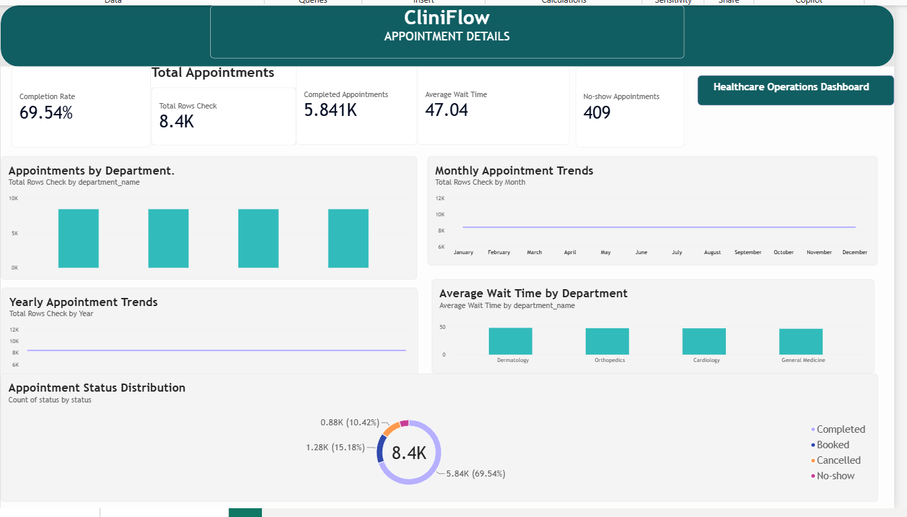
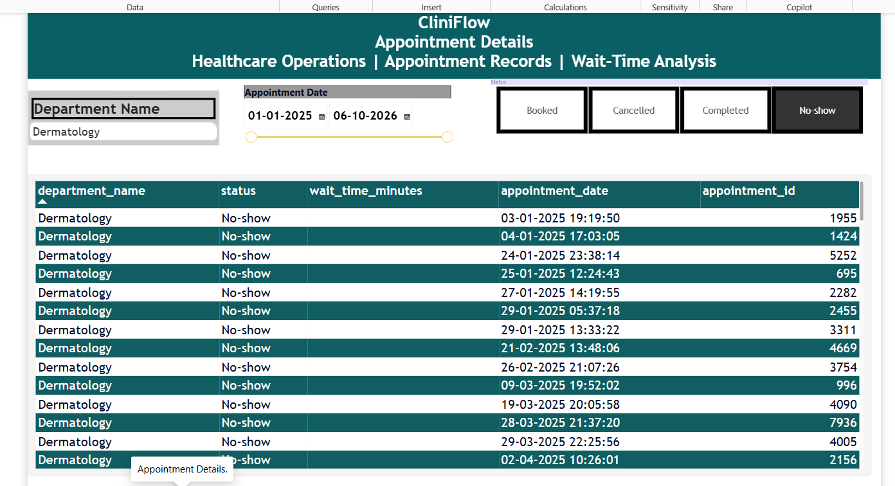

# CliniFlow – Healthcare Operations Analytics

## Project Overview
CliniFlow is a healthcare operations analytics project designed to analyse hospital appointment records, monitor appointment performance, and understand outpatient department (OPD) waiting times.

The project uses Python, PostgreSQL, and Power BI to organise appointment data, perform analysis, and present operational insights through interactive dashboards.

## Problem Statement
Healthcare facilities need to monitor appointment completion, cancellations, no-shows, and patient waiting times. CliniFlow helps make these operational patterns easier to understand through data analysis and visualisation.

## Tools and Technologies
- **Python:** Data handling and analysis
- **PostgreSQL:** Database storage and SQL queries
- **Power BI:** Interactive dashboards and visualisations
- **DAX:** KPI calculations
- **Git/GitHub:** Version control and project sharing

## Key Performance Indicators
- Total Appointments
- Completed Appointments
- Appointment Completion Rate
- Average Waiting Time
- No-show Appointments

## Dashboard Features
- Appointment status distribution
- Department-wise appointment analysis
- Monthly appointment trends
- Yearly appointment trends
- Average waiting time by department
- Department and date filters
- Appointment details table

## Project Structure
```text
CliniFlow/
│
├── app.py
├── cliniflow_appointments.csv
├── CliniFlow_Dashboard.pbix
└── README.md
```

## Dashboard
The Power BI dashboard provides an interactive view of healthcare appointment performance and operational trends.

## Learning Outcomes
- Working with structured data using Python
- Connecting Python and PostgreSQL
- Writing SQL queries for analysis
- Creating DAX measures
- Building interactive Power BI dashboards
- Understanding healthcare operational KPIs

## Disclaimer
This is an educational analytics project. Any synthetic or sample data used does not represent real patients or actual hospital records.


## Dashboard Preview

### Healthcare Operations Dashboard


### Appointment Details
